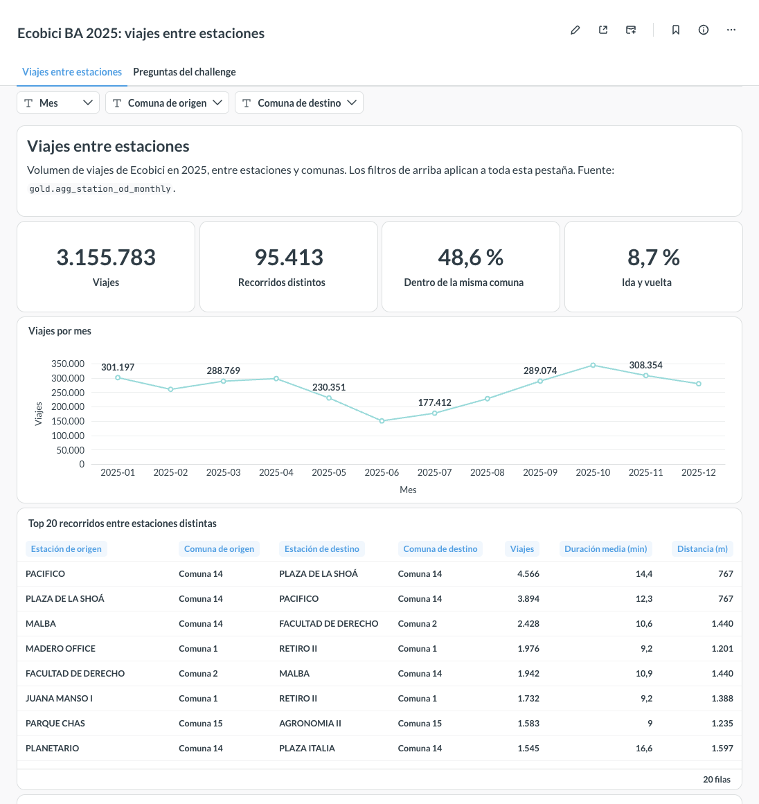
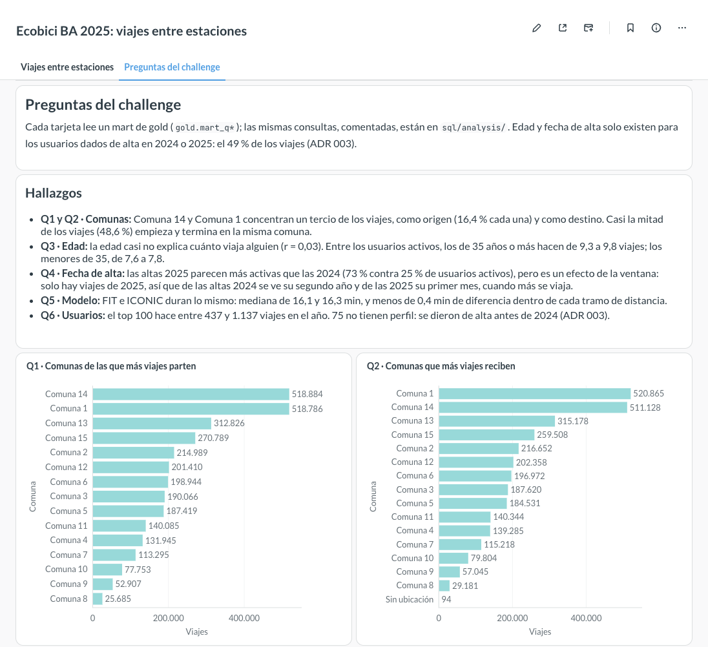
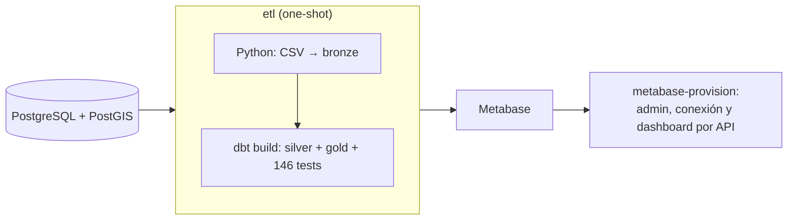

<div align="center">

<picture>
  <source media="(prefers-color-scheme: dark)" srcset="docs/assets/fudo-logo-white.svg">
  
</picture>
</div>

# FUDO Data Engineer Challenge (🚲 Ecobici BA 2025)

Pipeline de datos de punta a punta sobre los 3,1 M de viajes del sistema de bicicletas públicas de Buenos Aires en 2025: ingesta, limpieza, modelo relacional, consultas analíticas y dashboard. Se levanta con **un solo comando** y no requiere ningún paso manual.


<p align="center">
  
  
</p>

---

## 🚀 Quickstart

**Requisitos:** Docker con Docker Compose; probado con 6 GB de memoria asignados a Docker Desktop. Para desarrollo local, además [uv](https://docs.astral.sh/uv/).

```bash
# 1. Descargar los datasets en data/raw/ (ver "Datasets")
# 2. Levantar todo: crea .env desde .env.example si no existe
make up          # ~3 min la primera vez
# 3. Abrir el dashboard
open http://localhost:3000
```

El usuario de Metabase es `MB_ADMIN_EMAIL` y la clave `MB_ADMIN_PASSWORD`, los dos en `.env` (por defecto, `admin@example.com` / `change-me-admin1`). El dashboard abre como página de inicio.

`make up` hace, en orden:



Si cualquier paso falla, `make up` termina con error: Metabase solo arranca si el ETL terminó bien.

## 🏗️ Arquitectura

Arquitectura **medallion** sobre PostgreSQL, un schema por capa:

```
data/raw/*.csv ──► 🥉 bronze ──► 🥈 silver ──► 🥇 gold ──► 📊 Metabase
                   crudo, TEXT    tipado, limpio   modelo estrella
                   (Python COPY)  (dbt)            + agregados y marts (dbt)
```

| Capa | Qué tiene | Cómo se construye |
|---|---|---|
| 🥉 **bronze** | Los CSV tal cual llegan, todo como texto, con archivo y número de fila de origen. | Python con `COPY`. Idempotente: un hash SHA-256 por archivo decide si se recarga. |
| 🥈 **silver** | Datos tipados, normalizados y deduplicados. Lo que no pasa las reglas va a `*_rejected` con el motivo. | dbt. `silver.reconciliation` controla que bronze = silver + rechazados. |
| 🥇 **gold** | Modelo estrella (`fct_trips` + 5 dimensiones), agregado origen-destino mensual para el dashboard y un mart por pregunta. | dbt, con `vacuum analyze` después de cada tabla. |

Detalle del modelo, con tipos y linaje: [docs/er-diagram.md](docs/er-diagram.md). Documentación interactiva de dbt: `make docs` y abrir http://localhost:8080.

**Seguridad:** el ETL escribe con el rol `etl` y Metabase lee con `bi_reader`, que solo puede leer `gold`. Las credenciales salen de `.env`; no hay ninguna en el código.

## ❓ Respuestas

Cada pregunta está respondida de dos formas: como mart en gold, que alimenta el dashboard, y como SQL comentado en [sql/analysis/](sql/analysis/), que se corre con `make sql` (o `make sql q=q3` para una sola).

| | Pregunta | Respuesta corta |
|---|---|---|
| 🏙️ | Comunas de las que más viajes parten | Comuna 14 y Comuna 1, con el 16,4 % cada una. Casi la mitad de los viajes (48,6 %) empieza y termina en la misma comuna. |
| 🎯 | Comunas que más viajes reciben | Las mismas: Comuna 1 (16,5 %) y Comuna 14 (16,2 %). |
| 🎂 | Edad vs. cantidad de viajes | Casi no hay relación (r = 0,03). Entre los usuarios activos, los de 35 años o más hacen algo más de viajes (9,3–9,8) que los menores de 35 (7,6–7,8). |
| 📅 | Fecha de alta vs. cantidad de viajes | Casi todo el uso se concentra en el primer mes desde el alta, y después la mayoría abandona. La comparación entre las altas 2024 y 2025 está sesgada (ver "Limitaciones"). |
| ⏱️ | Duración vs. modelo de bicicleta | No hay diferencia: mediana de 16,1 min (FIT) y 16,3 min (ICONIC), y menos de 0,4 min de diferencia dentro de cada tramo de distancia. |
| 🏆 | Usuarios más activos de 2025 | El top 100 hace entre 437 y 1.137 viajes en el año; el primero, más de 3 por día con viajes. 75 de esos 100 se dieron de alta antes de 2024. |

## ✅ Calidad de datos

| Entidad | Bronze | Silver | Rechazados | Motivo |
|---|--:|--:|--:|---|
| Viajes | 3.156.182 | 3.155.783 | 399 | 398 duran más de 24 h; 1 no tiene estación |
| Usuarios (altas 2024 y 2025) | 389.751 | 389.751 | 0 | |
| Estaciones (catálogo actual) | 407 | 413 | 0 | Se suman 6 estaciones que solo aparecen en los viajes |
| Comunas | 15 | 15 | 0 | |

- **146 tests de dbt** cubren unicidad, nulos, relaciones entre tablas, valores aceptados, rangos y reconciliaciones (bronze = silver + rechazados, marts = `fct_trips`). Hay 1 warning esperado: 8 viajes terminan en el mismo segundo en que empiezan, y se conservan.
- **Reglas de limpieza:** IDs con sufijos (`146BAEcobici`, `1.0`), separadores de miles, coordenadas en 0 o fuera de CABA, géneros y fechas inválidas. Están documentadas columna por columna en el [diccionario de datos](docs/data-dictionary.md).
- **Profiling previo** de los archivos crudos: [docs/profiling/profile.md](docs/profiling/profile.md).

## 🧭 Decisiones y trade-offs

| Decisión | Por qué | Trade-off |
|---|---|---|
| **dbt para silver y gold**, Python solo para la ingesta | Transformaciones en SQL versionadas, con tests, documentación y linaje. | Una herramienta más en el stack. |
| **Sin orquestador** (Makefile + un contenedor one-shot) | Es una carga anual batch: Airflow o Dagster agregarían infraestructura sin aportar nada acá. | Sin reintentos ni scheduling; para cargas periódicas sería lo primero a sumar. |
| **Comunas con PostGIS** ([ADR 001](docs/adr/001-comuna-assignment.md)) | Los datasets no traen la comuna: se asigna por punto en polígono, y por cercanía si la estación cae fuera de todos (Aeroparque). | Depende del GeoJSON oficial versionado en `data/reference/`. |
| **Catálogo de estaciones actual** ([ADR 002](docs/adr/002-station-catalog.md)) | El catálogo viejo reutiliza IDs de otras estaciones: el 131 es "Retiro III" en uno y "Hospital de Clínicas" en el otro, a 2,4 km. El viejo queda en bronze, pero no se usa. | 6 estaciones que no están en el catálogo actual se completan con los datos de los viajes. |
| **Usuarios 2024 y 2025** ([ADR 003](docs/adr/003-users-coverage.md)) | Con solo las altas 2025, el 27 % de los viajes tenía perfil; sumando 2024, el 49 %. El resto son usuarios dados de alta antes de 2024. | Q3 y Q4 se responden sobre ese 49 %; `has_profile` lo marca en `dim_user`. |
| **Silver y gold como tablas**, vistas solo sobre bronze | dbt-postgres reemplaza tablas con `drop ... cascade` y se llevaría las vistas que dependen de ellas. | Más espacio en disco. |
| **Agregado origen-destino mensual** para el dashboard | El dashboard nunca toca los 3,1 M de viajes: 42× más rápido que consultar `fct_trips`. | Un modelo más que mantener. |
| **Metabase como código** ([metabase/](metabase/)) | Admin, conexión y dashboard se crean por API: reproducible y revisable en un diff. | Los cambios hechos a mano en Metabase se pisan en el próximo `make up`. |

**Optimización SQL** ([sql/optimization/](sql/optimization/README.md)): medí todo con `EXPLAIN ANALYZE` antes y después. El build bajó un 29 % y la consulta de Q6 se hizo 5,4× más rápida, sin cambiar ningún dato. El particionado mensual de `fct_trips` se midió y se descartó: con un solo año de datos no reduce lo que se lee.

## ⚠️ Limitaciones de los datos

- **Edad y fecha de alta** solo existen para el 49 % de los viajes, los de usuarios dados de alta en 2024 o 2025. De los anteriores no hay archivo de usuarios.
- **Q4 compara años distintos con la misma vara.** Solo hay viajes de 2025: de las altas 2024 se ve su segundo año, y de las 2025 su primer mes, que es cuando más se viaja. Por eso las altas 2025 parecen mucho más activas (73 % contra 25 %). La comparación justa es por antigüedad desde el alta (ver "Próximos pasos").
- **Estación 510 "[Valet] Galpón":** no tiene ubicación (viene con coordenadas en 0). Se conserva para no perder sus viajes, pero queda sin comuna ni distancia.
- **Distancia** es en línea recta entre estaciones, no el recorrido real.

## 🧪 Cómo probar

```bash
make test                 # 93 tests de Python (ingesta, profiling, benchmark, provisión de Metabase)
make dbt c=test           # los 146 tests de datos de dbt
make sql                  # las 6 consultas de análisis, como bi_reader
make lint                 # ruff + sqlfluff (pre-commit)
make reset FORCE=1        # todo desde cero: borra los volúmenes y vuelve a levantar
```

Para chequear la reconciliación a mano, `make psql` y:

```sql
select * from silver.reconciliation;   -- bronze = silver + rechazados, por entidad
```

## 🔭 Próximos pasos

- **Q4 por cohortes:** retención en ventanas de 30 días desde el alta, solo para las cohortes 2025, que se observan desde el primer día.
- **Panel de calidad de datos** en el dashboard: reconciliación y rechazos por motivo, expuestos en gold.
- **CI** (GitHub Actions): lint, tests de Python y `dbt build` sobre una muestra de los datos.
- **Cargas incrementales y un orquestador** si los datos llegan periódicamente: modelos incrementales en dbt, y reintentos y alertas en Dagster o Airflow.
- **Infraestructura:**
  - **Memoria de Postgres:** subir `work_mem` y `shm_size`, que hoy están en los valores de fábrica. Q3–Q6 escriben ordenamientos a disco, y el `VACUUM` paralelo de índices no entra en los 64 MB de `/dev/shm` que da Docker (hoy se evita con `parallel 0`).
  - **Rotación de logs** en todos los servicios (`max-size` y `max-file`), para que los logs de Docker no crezcan sin límite.
  - **Log de consultas lentas** en Postgres (`log_min_duration_statement`), para detectar regresiones de rendimiento.
  - **Imagen alpine de PostGIS:** evaluarla por tamaño, revalidando el orden de los textos en español, que con musl puede cambiar.

## 📦 Datasets

Fuente: [Buenos Aires Data](https://data.buenosaires.gob.ar). Descargar cada archivo en `data/raw/` con el nombre indicado:

| | Dataset | Archivo esperado | Descarga |
|---|---|---|---|
| 🚲 | Recorridos 2025 | `ecobici-datasets-2025.csv` | [⬇️ zip](https://data.buenosaires.gob.ar/dataset/bicicletas-publicas/resource/d860362d-99f9-49a2-9ea0-1afd65581a97/download) (descomprimir `Trips.csv` y renombrar) |
| 👤 | Usuarios 2025 | `usuarios-ecobici-2025.csv` | [⬇️ csv](https://data.buenosaires.gob.ar/dataset/bicicletas-publicas/resource/f522cefa-d113-4871-bb0f-559ccfdbd639/download) |
| 👤 | Usuarios 2024 | `usuarios-ecobici-2024.csv` | [⬇️ csv](https://data.buenosaires.gob.ar/dataset/bicicletas-publicas/resource/b7ee1b17-3f70-4dbd-877b-7abc5e3ba7d4/download) |
| 📍 | Estaciones (sistema actual) | `estaciones.csv` | [⬇️ csv](https://data.buenosaires.gob.ar/dataset/estaciones-bicicletas-publicas/resource/1d21a28a-bb2b-4ddb-b00b-77f82f3e34fb/download) |
| 📍 | Estaciones (sistema inicial) | `estaciones-sistema-viejo.csv` | [⬇️ csv](https://data.buenosaires.gob.ar/dataset/estaciones-bicicletas-publicas/resource/juqdkmgo-1011-resource/download) |
| 🗺️ | Comunas (polígonos) | `data/reference/comunas.geojson` | ✅ ya incluido en el repo ([fuente](https://cdn.buenosaires.gob.ar/datosabiertos/datasets/ministerio-de-educacion/comunas/comunas.geojson)) |

> ℹ️ El modelo usa el **catálogo actual** de estaciones (`estaciones.csv`). El del sistema inicial se carga en bronze para tener trazabilidad, pero no se usa, porque reutiliza IDs de otras estaciones ([ADR 002](docs/adr/002-station-catalog.md)).
>
> `data/raw/` no se versiona. `data/reference/` sí: son datos auxiliares chicos que el pipeline necesita para funcionar sin internet.

## 🛠️ Comandos

`make help` lista todos:

| Comando | Qué hace |
|---|---|
| `make up` / `make down` | Levanta / detiene el stack |
| `make reset` | Borra los datos y levanta desde cero (`FORCE=1` para no preguntar) |
| `make ps` · `make logs` | Estado y logs de los servicios (`s=postgres` para uno solo) |
| `make psql` | Consola SQL en la base analítica |
| `make etl` · `make dbt` | Corre el pipeline completo / un comando de dbt (`c="build --select gold"`) |
| `make provision` | Vuelve a configurar Metabase (admin, conexión y dashboard); idempotente |
| `make sql` | Corre las 6 consultas de análisis (`q=q3` para una sola) |
| `make docs` | Documentación de dbt (modelos, columnas, tests y linaje) en http://localhost:8080 |
| `make setup` · `make test` · `make lint` | Entorno local, tests y linters |
| `make profile` | Regenera el reporte de profiling de los datasets |
| `make bench label=x` | Mide consultas y build de dbt (`baseline=y` para comparar) |

## 📁 Estructura

```
specs/          📋 plan, especificación y tareas (Spec-Driven Development)
etl/            🐍 ingesta a bronze, profiling y benchmark (Python) + tests
dbt/            🔧 modelos staging, silver y gold, macros de limpieza y tests
sql/            🗄️ init de la base (schemas y roles), análisis Q1–Q6 y optimización
metabase/       📊 provisión del dashboard por API
docs/           📚 diagrama ER, diccionario de datos, ADRs y profiling
data/raw/       📥 datasets de entrada (no versionado)
data/reference/ 🗺️ GeoJSON de comunas (versionado)
```

## 📋 Documentación

El proyecto se desarrolló con **Spec-Driven Development**: primero el plan y la especificación, después las tareas, una por commit.

🤖 Lo trabajé con [Claude Code](https://claude.com/claude-code) como copiloto. Yo definí el alcance, el stack y las decisiones sobre los datos, y revisé cada tarea antes de commitearla. Claude implementó y propuso alternativas dentro de ese marco.

- 🧭 [plan.md](specs/plan.md): stack, arquitectura y decisiones técnicas.
- 📐 [spec.md](specs/spec.md): requerimientos, reglas de calidad de datos y criterios de aceptación.
- ✅ [tasks.md](specs/tasks.md): tareas por fase y su estado.

**Documentación complementaria:**

- 🗺️ [er-diagram.md](docs/er-diagram.md): modelo estrella y linaje de los datos.
- 📖 [data-dictionary.md](docs/data-dictionary.md): cada columna, del archivo a silver, con sus reglas de limpieza.
- 🧾 [docs/adr/](docs/adr/README.md): decisiones de datos (comunas, catálogo de estaciones, cobertura de usuarios).
- ⚡ [sql/optimization/](sql/optimization/README.md): mediciones con `EXPLAIN ANALYZE`, qué se cambió y qué se descartó.
- 📝 [CHALLENGUE.md](CHALLENGUE.md): enunciado original.
