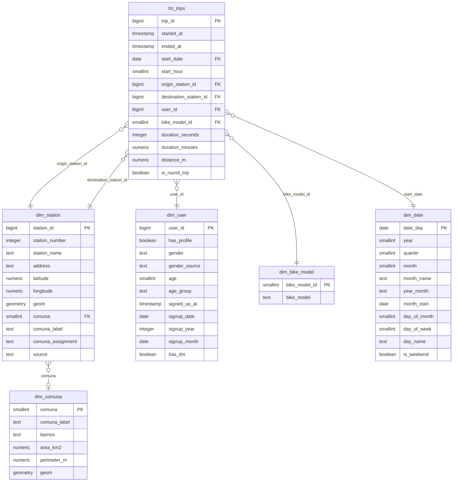
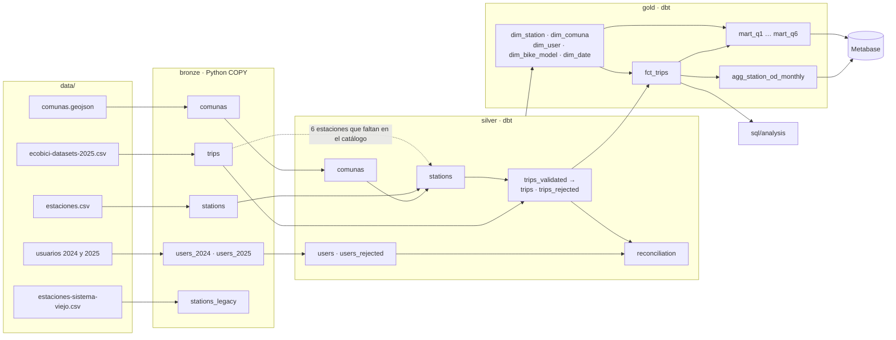

  <picture>
    <source media="(prefers-color-scheme: dark)" srcset="assets/fudo-logo-white.svg">
    
  </picture>

# Modelo de datos

El modelo analítico vive en el schema `gold` de PostgreSQL. Es un **modelo estrella**: una tabla de hechos con un viaje por fila y cinco dimensiones. Sobre él se construyen un agregado origen-destino para el dashboard y un mart por cada pregunta del challenge.

La documentación interactiva de cada modelo, columna y test, con el linaje completo, se genera con dbt: `make docs` y abrir http://localhost:8080.

## Modelo estrella (`gold`)

| Tabla | Grano | Filas | Notas |
|---|---|---|---|
| `fct_trips` | viaje | 3.155.783 | Viajes 2025 válidos. `distance_m` es la distancia en línea recta entre estaciones, no el recorrido. |
| `dim_station` | estación | 413 | 407 del catálogo actual + 6 que solo aparecen en los viajes (ADR 002). La 510 no tiene ubicación (`comuna` NULL). |
| `dim_comuna` | comuna | 15 | Polígonos oficiales (ADR 001). |
| `dim_user` | usuario | 487.262 | Usuarios con viajes y usuarios con alta 2024-2025 aunque no hayan viajado. `has_profile` = tiene edad y fecha de alta (ADR 003). |
| `dim_bike_model` | modelo | 2 | FIT e ICONIC. |
| `dim_date` | día | 732 | Del 2024-01-01 (primera alta) al 2026-01-01 (último fin de viaje). |

Todas las claves foráneas tienen un test de `relationships` en dbt, y `fct_trips` tiene un test que exige las mismas filas que `silver.trips`: ningún viaje se pierde en los joins.

## Agregados y marts (`gold`)

| Tabla | Grano | Para qué |
|---|---|---|
| `agg_station_od_monthly` | mes × estación de origen × estación de destino | Volumen de viajes entre estaciones a lo largo del año (dashboard). Trae nombres, comunas y coordenadas de las dos estaciones. |
| `int_user_trips` | usuario | Viajes, duración y días activos de cada usuario de `dim_user` (incluye los de 0 viajes). Base de los marts de Q3, Q4 y Q6. |
| `mart_q1_comunas_origin` | comuna | Q1: comunas de las que más viajes parten. |
| `mart_q2_comunas_destination` | comuna | Q2: comunas que más viajes reciben. |
| `mart_q3_trips_by_age_group` | rango etario | Q3: viajes por edad. |
| `mart_q3_age_correlation` | universo de usuarios | Q3: correlación y regresión viajes ~ edad. |
| `mart_q4_trips_by_signup_month` | mes de alta | Q4: viajes por cohorte, normalizados por exposición. |
| `mart_q5_duration_by_bike_model` | modelo | Q5: duración por modelo. |
| `mart_q5_duration_by_model_and_distance` | tramo de distancia × modelo | Q5: control por distancia. |
| `mart_q6_top_users` | usuario (top 100) | Q6: usuarios más activos. |

## Linaje: de los archivos al dashboard

- `bronze.stations_legacy` no sigue a silver: el catálogo viejo reutiliza IDs de otras estaciones (ADR 002).
- Las vistas de staging (`silver.stg_bronze__*`) tipan bronze. Son las únicas vistas del proyecto: silver y gold se materializan como tablas, porque dbt-postgres reemplaza tablas con `drop ... cascade` y se llevaría las vistas que dependen de ellas.
- `silver.trips_validated` es una tabla intermedia (`unlogged`): limpia los viajes una sola vez y de ahí salen los válidos y los rechazados (T6.2).
- Cada tabla de silver y gold se crea con `vacuum (analyze)` como post-hook, así queda lista para consultar al terminar el build (T6.2).
- `silver.reconciliation` controla que bronze = silver + rechazados en cada entidad.
- Metabase se conecta con `bi_reader`, que solo puede leer `gold`.
